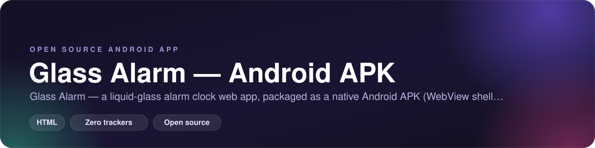

<div align="center">




<a href="https://github.com/technicalnihilist-lgtm/glass-alarm-android/stargazers"></a>&nbsp;<a href="https://github.com/technicalnihilist-lgtm/glass-alarm-android/network/members"></a>

<a href="https://github.com/technicalnihilist-lgtm/glass-alarm-android/releases/latest/download/Glass_Alarm.apk"></a> <a href="https://technicalnihilist-lgtm.github.io/apps-site/apps/glass-alarm-android.html"></a>

<b>Support the work</b>

  

<sub>Donations aren't live yet — Paytm, UPI, PayPal and Buy&nbsp;Me&nbsp;a&nbsp;Coffee all show <b>coming soon</b>. Until then, a ⭐ star is the best support.</sub>

<a href="https://github.com/technicalnihilist-lgtm/glass-alarm-android/releases/latest"></a>  <a href="https://github.com/technicalnihilist-lgtm/glass-alarm-android/releases"></a>

</div>

---

## Screenshots

| Home screen (light) | Alarms (dark) | New alarm (dark) |
|---|---|---|
|  |  |  |

Screenshots are rendered at 412 × 915 CSS px from the exact HTML that ships inside the APK.

## Install

**On a phone, directly:** copy `dist/Glass_Alarm.apk` to the device and tap it. Android will ask you to allow installs from that source (Settings → Install unknown apps) the first time.

**With adb:**

```bash
adb install -r dist/Glass_Alarm.apk
```

No `INTERNET` permission at all: the page is one self-contained file loaded from the APK over
`file:///android_asset/`, with the fonts embedded as `data:` URIs. The app has no network path
whatsoever and runs fine in airplane mode.

## What the native shell does

The shell is one `Activity` and about 300 lines of Java. It deliberately does very little, because the design already handles everything else:

- **Loads one self-contained file from APK assets over `file:///android_asset/`.** The HTML has its fonts embedded as `data:` URIs, so there are no subresources and nothing to fail at load time. `setAllowFileAccess(true)` is set explicitly — for targetSdk 30+ the WebView default is `false` and would block the load entirely.
- **Embeds the Outfit font** (weights 200–600) inside the HTML so typography is identical with no network. The only edits to the original HTML are that one `<link>` to Google Fonts, replaced by `@font-face` rules, and the optimised displacement-map builder — everything else is the original.
- **Immersive edge-to-edge, portrait, no action bar**, dark window background so there is no white flash at launch.
- **Disables WebView's algorithmic darkening**, so the page's own light/dark theme handling stays in charge.
- **Allows media to play without a per-tap gesture**, so alarm chimes can fire on their own. `VIBRATE` and `WAKE_LOCK` permissions back `navigator.vibrate` and the screen wake lock.
- **Hardware back** walks out the way the UI would: stop a ringing alarm → close settings → close the sheet → close the app → exit.
- **Failure paths are reported, not fatal:** an uncaught exception is written to internal storage and shown on the next launch as selectable text (with Android version, device model and WebView version), `onCreate` is wrapped so a startup failure shows its stack trace, and a killed renderer is rebuilt once before a readable report appears.
- **The screen stays awake natively** (`FLAG_KEEP_SCREEN_ON`), since the page's Wake Lock API needs a secure origin.

## Project layout

```
app/
  AndroidManifest.xml
  src/com/rajok/glassalarm/MainActivity.java   # the whole shell
  assets/index.html                            # the app itself: fonts embedded, no subresources
  res/                                         # theme, adaptive launcher icon
tools/make_icons.py                            # generates every launcher icon PNG
build.sh                                       # aapt2 + javac + d8 + apksigner
docs/screenshots/
dist/Glass_Alarm.apk
```

## Build from source

No Gradle, no Android Studio project to import — `build.sh` drives the SDK tools directly, which keeps the build to a few seconds and the whole thing inspectable.

Requirements: **JDK 17**, **Android SDK build-tools 34.0.0**, **platform android-34**.

```bash
export ANDROID_SDK_ROOT=/path/to/android-sdk
export JAVA_HOME=/path/to/jdk-17
./build.sh          # -> Glass_Alarm.apk
```

The script runs `aapt2 compile` → `aapt2 link` → `javac` → `d8` → `zipalign` → `apksigner`.

### Signing

The APK in `dist/` is signed with a locally generated keystore. **That keystore is not committed** (see `.gitignore`) — generate your own before publishing, and keep it safe: Android will only let you update an installed app with a build signed by the same key.

```bash
keytool -genkeypair -keystore my-release.jks -alias glassalarm \
  -keyalg RSA -keysize 2048 -validity 10950
```

## Stability notes

Version 1.0 shipped without the `INTERNET` permission, which stops WebView from loading any
`https` URL — the page never appeared. 1.1 fixes that along with renderer-crash recovery and a
much cheaper displacement-map build. Details in the [CHANGELOG](CHANGELOG.md).

## Known limitations

These are properties of the web app, not the packaging:

- Alarms only ring **while the page stays open**, as the app itself states. If Android kills the app in the background, or the device has been asleep for a long time, a pending alarm will not fire. A truly system-level alarm would need `AlarmManager` plus a foreground service, and the schedule moved out of `localStorage` into native code.
- The original design is a phone mockup rendered inside a page, so on a phone you see the mockup's frame with a small margin. It is reproduced as-is.

## Credits

UI: the original `Glass_Alarm.html` single-page app. Font: [Outfit](https://fonts.google.com/specimen/Outfit) by Smartsheet Inc. (SIL Open Font License), bundled for offline use.

---

## 🌍 Languages

<sub>Donations are <b>coming soon</b> in every language below — nothing to pay today, nothing to click.</sub>

<div align="center">

<sub><b>हिन्दी · বাংলা · मराठी · తెలుగు · தமிழ் · ગુજરાતી · ಕನ್ನಡ · മലയാളം · ਪੰਜਾਬੀ · ଓଡ଼ିଆ · অসমীয়া · اردو</b></sub>

</div>

<details>
<summary><b>🌍 Open the same message in 53 languages</b></summary>

**🇮🇳 Indian languages**

- **हिन्दी** (Hindi) — ☕ जल्द ही आ रहा है। · ⭐ अगर आपको यह ऐप और हमारा काम पसंद है, तो कृपया रिपॉजिटरी को स्टार दें और हमें फॉलो करें।
- **বাংলা** (Bengali) — ☕ খুব শিগগিরই আসছে। · ⭐ যদি আপনার এই অ্যাপ এবং আমাদের কাজ ভালো লাগে, তবে অনুগ্রহ করে রিপোজিটরিটিকে একটি স্টার দিন এবং আমাদের ফলো করুন।
- **मराठी** (Marathi) — ☕ लवकरच येत आहे. · ⭐ जर तुम्हाला हे ॲप आणि आमचं काम आवडलं असेल, तर कृपया रिपॉझिटरीला स्टार द्या आणि आम्हाला फॉलो करा.
- **తెలుగు** (Telugu) — ☕ త్వరలో రాబోతోంది. · ⭐ మీకు ఈ యాప్, మా పని నచ్చితే, దయచేసి రిపోజిటరీకి ఒక స్టార్ ఇచ్చి మమ్మల్ని ఫాలో అవ్వండి.
- **தமிழ்** (Tamil) — ☕ விரைவில் வருகிறது. · ⭐ உங்களுக்கு இந்த ஆப்பும் எங்க வேலையும் பிடிச்சிருந்தா, தயவுசெஞ்சு இந்த ரெபாசிட்டரிக்கு ஒரு ஸ்டார்…
- **ગુજરાતી** (Gujarati) — ☕ ટૂંક સમયમાં આવી રહ્યું છે. · ⭐ જો તમને આ એપ અને અમારું કામ ગમતું હોય, તો પ્લીઝ રિપોઝિટરીને સ્ટાર આપો અને અમને ફોલો કરો.
- **ಕನ್ನಡ** (Kannada) — ☕ ಶೀಘ್ರದಲ್ಲೇ ಬರುತ್ತಿದೆ. · ⭐ ನಿಮಗೆ ಈ ಆ್ಯಪ್ ಮತ್ತು ನಮ್ಮ ಕೆಲಸ ಇಷ್ಟವಾದರೆ, ದಯವಿಟ್ಟು ರೆಪೊಸಿಟರಿಗೆ ಸ್ಟಾರ್ ಕೊಡಿ ಮತ್ತು ನಮ್ಮನ್ನು ಫಾಲೋ ಮಾಡಿ.
- **മലയാളം** (Malayalam) — ☕ ഉടൻ വരുന്നു. · ⭐ നിങ്ങൾക്ക് ഈ ആപ്പും ഞങ്ങളുടെ പ്രവർത്തനവും ഇഷ്ടപ്പെട്ടെങ്കിൽ, ദയവായി റെപ്പോസിറ്ററിക്ക് ഒരു സ്റ്റാർ…
- **ਪੰਜਾਬੀ** (Punjabi) — ☕ ਜਲਦੀ ਆ ਰਿਹਾ ਹੈ। · ⭐ ਜੇ ਤੁਹਾਨੂੰ ਇਹ ਐਪ ਅਤੇ ਸਾਡਾ ਕੰਮ ਪਸੰਦ ਹੈ, ਤਾਂ ਕਿਰਪਾ ਕਰਕੇ ਰਿਪੋਜ਼ਟਰੀ ਨੂੰ ਸਟਾਰ ਦਿਓ ਅਤੇ ਸਾਨੂੰ ਫਾਲੋ ਕਰੋ।
- **ଓଡ଼ିଆ** (Odia) — ☕ ଖୁବ୍ ଶୀଘ୍ର ଆସୁଛି। · ⭐ ଯଦି ଆପଣଙ୍କୁ ଏହି ଆପ୍ ଏବଂ ଆମର କାମ ଭଲ ଲାଗୁଛି, ତେବେ ଦୟାକରି ରିପୋଜିଟୋରୀକୁ ଗୋଟିଏ ଷ୍ଟାର୍ ଦିଅନ୍ତୁ ଏବଂ ଆମକୁ ଫଲୋ କରନ୍ତୁ।
- **অসমীয়া** (Assamese) — ☕ অতি সোনকালেই আহি আছে। · ⭐ যদি আপুনি এই এপটো আৰু আমাৰ কাম ভাল পায়, তেন্তে অনুগ্ৰহ কৰি ৰিপজিটৰীটোক এটা ষ্টাৰ দিয়ক আৰু আমাক ফ'ল' কৰক।
- **اردو** (Urdu) — ☕ جلد آرہا ہے۔ · ⭐ اگر آپ کو یہ ایپ اور ہمارا کام پسند آئے تو براہ کرم ریپازٹری کو سٹار دیں اور ہمیں فالو کریں۔
- **संस्कृतम्** (Sanskrit) — ☕ शीघ्रमेव आगच्छति।
- **मैथिली** (Maithili) — ☕ जल्दिये आबि रहल अछि।
- **कोंकणी** (Konkani) — ☕ रोखडेंच येता.
- **کٲشُر** (Kashmiri) — ☕ جَلدی یِوان چھُ۔
- **سنڌي** (Sindhi) — ☕ जल्द अची रह्यो आहे।
- **डोगरी** (Dogri) — ☕ जल्दी आ करदा ऐ।
- **ꯃꯤꯇꯩ ꯂꯣꯟ** (Manipuri) — ☕ ꯑꯊꯨꯕꯥ ꯃꯇꯝꯗꯥ ꯂꯥꯛꯀꯅꯤ꯫
- **बर’** (Bodo) — ☕ थाबैनो फैगोन।
- **ᱥᱟᱱᱛᱟᱲᱤ** (Santali) — ☕ ᱞᱚᱜᱚᱱ ᱦᱤᱡᱩᱜ ᱠᱟᱱᱟ᱾
- **नेपाली** (Nepali) — ☕ छिट्टै आउँदैछ। · ⭐ यदि तपाईंलाई यो एप र हाम्रो काम मन पर्‍यो भने, कृपया रिपोजिटरीलाई स्टार दिनुहोस् र हामीलाई फलो गर्नुहोस्।

**🌍 World languages**

- **العربية** (Arabic) — ☕ قريبًا. · ⭐ إذا أعجبك هذا التطبيق وعملنا، فيرجى منح المستودع نجمة ومتابعتنا.
- **简体中文** (Chinese (Simplified)) — ☕ 即将推出。
- **繁體中文** (Chinese (Traditional)) — ☕ 即將推出。
- **Čeština** (Czech) — ☕ Již brzy.
- **Dansk** (Danish) — ☕ Kommer snart.
- **Nederlands** (Dutch) — ☕ Binnenkort beschikbaar. · ⭐ Vind je deze app en ons werk leuk?
- **Filipino** (Filipino) — ☕ Malapit na.
- **Suomi** (Finnish) — ☕ Tulossa pian.
- **Français** (French) — ☕ Bientôt disponible. · ⭐ Si cette application et notre travail vous plaisent, mettez une étoile au dépôt et suivez-nous.
- **Deutsch** (German) — ☕ Bald verfügbar. · ⭐ Wenn dir diese App und unsere Arbeit gefallen, gib dem Repository einen Stern und folge uns.
- **Ελληνικά** (Greek) — ☕ Έρχεται σύντομα.
- **עברית** (Hebrew) — ☕ בקרוב.
- **Magyar** (Hungarian) — ☕ Hamarosan.
- **Bahasa Indonesia** (Indonesian) — ☕ Segera hadir. · ⭐ Jika kamu suka aplikasi ini dan karya kami, beri bintang pada repositori ini dan ikuti kami.
- **Italiano** (Italian) — ☕ In arrivo.
- **日本語** (Japanese) — ☕ 近日公開。 · ⭐ このアプリと私たちの仕事が気に入ったら、リポジトリにスターを付けてフォローしてください。
- **한국어** (Korean) — ☕ 곧 공개됩니다. · ⭐ 이 앱과 저희 작업이 마음에 드신다면 저장소에 스타를 눌러 주시고 팔로우해 주세요.
- **Bahasa Melayu** (Malay) — ☕ Akan datang.
- **Norsk** (Norwegian) — ☕ Kommer snart.
- **فارسی** (Persian) — ☕ به‌زودی.
- **Polski** (Polish) — ☕ Wkrótce. · ⭐ Jeśli podoba Ci się ta aplikacja i nasza praca, daj repozytorium gwiazdkę i obserwuj nas.
- **Português** (Portuguese) — ☕ Em breve.
- **Română** (Romanian) — ☕ În curând.
- **Русский** (Russian) — ☕ Скоро. · ⭐ Если вам нравится это приложение и наша работа, поставьте звёздочку репозиторию и подпишитесь на нас.
- **Español** (Spanish) — ☕ Muy pronto. · ⭐ Si te gusta esta app y nuestro trabajo, dale una estrella al repositorio y síguenos.
- **Kiswahili** (Swahili) — ☕ Inakuja hivi karibuni.
- **Svenska** (Swedish) — ☕ Kommer snart.
- **ไทย** (Thai) — ☕ เร็ว ๆ นี้
- **Türkçe** (Turkish) — ☕ Çok yakında.
- **Українська** (Ukrainian) — ☕ Незабаром.
- **Tiếng Việt** (Vietnamese) — ☕ Sắp ra mắt. · ⭐ Nếu bạn thích ứng dụng này và công việc của chúng tôi, hãy tặng kho lưu trữ một ngôi sao và theo…

</details>

