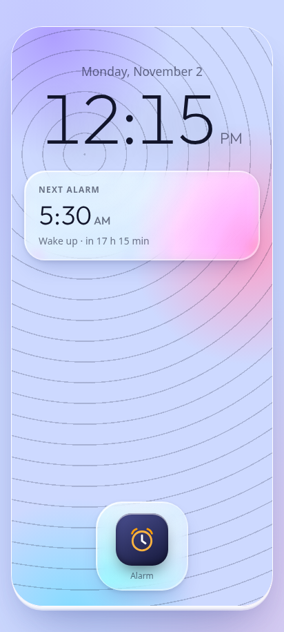
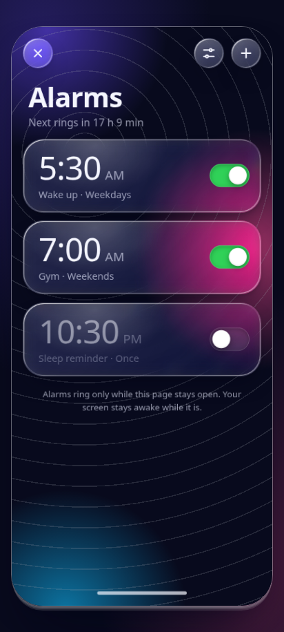
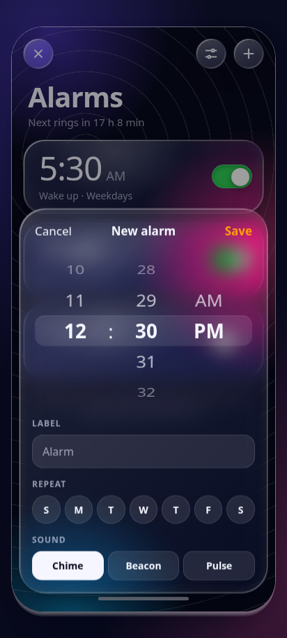

# Glass Alarm — Android APK

A liquid-glass alarm clock, packaged as a real, installable Android app.

The UI is a single self-contained HTML page (the original `Glass_Alarm.html`): a phone home screen with a dock icon that springs open into a full alarm app — glass cards, aurora wallpaper, an SVG refraction lens, custom alarm sounds synthesised with the Web Audio API, vibration and a screen wake lock. This repo wraps that page in a thin native Android shell so it installs and launches like any other app, works fully offline, and renders exactly as designed.

- **APK:** [`dist/Glass_Alarm.apk`](dist/Glass_Alarm.apk) (307 KB, signed, Android 7.0+)
- **Package:** `com.rajok.glassalarm`
- **Version:** 1.2 (versionCode 3) — see [CHANGELOG](CHANGELOG.md)
- **Min SDK:** 24 · **Target SDK:** 34

## Screenshots

| Home screen (light) | Alarms (dark) | New alarm (dark) |
|---|---|---|
|  |  |  |

Screenshots are rendered at 412 × 915 CSS px from the exact HTML that ships inside the APK.

## Install

**On a phone, directly:** copy `dist/Glass_Alarm.apk` to the device and tap it. Android will ask you to allow installs from that source (Settings → Install unknown apps) the first time.

**With adb:**

```bash
adb install -r dist/Glass_Alarm.apk
```

No `INTERNET` permission at all: the page is one self-contained file loaded from the APK over
`file:///android_asset/`, with the fonts embedded as `data:` URIs. The app has no network path
whatsoever and runs fine in airplane mode.

## What the native shell does

The shell is one `Activity` and about 300 lines of Java. It deliberately does very little, because the design already handles everything else:

- **Loads one self-contained file from APK assets over `file:///android_asset/`.** The HTML has its fonts embedded as `data:` URIs, so there are no subresources and nothing to fail at load time. `setAllowFileAccess(true)` is set explicitly — for targetSdk 30+ the WebView default is `false` and would block the load entirely.
- **Embeds the Outfit font** (weights 200–600) inside the HTML so typography is identical with no network. The only edits to the original HTML are that one `<link>` to Google Fonts, replaced by `@font-face` rules, and the optimised displacement-map builder — everything else is the original.
- **Immersive edge-to-edge, portrait, no action bar**, dark window background so there is no white flash at launch.
- **Disables WebView's algorithmic darkening**, so the page's own light/dark theme handling stays in charge.
- **Allows media to play without a per-tap gesture**, so alarm chimes can fire on their own. `VIBRATE` and `WAKE_LOCK` permissions back `navigator.vibrate` and the screen wake lock.
- **Hardware back** walks out the way the UI would: stop a ringing alarm → close settings → close the sheet → close the app → exit.
- **Failure paths are reported, not fatal:** an uncaught exception is written to internal storage and shown on the next launch as selectable text (with Android version, device model and WebView version), `onCreate` is wrapped so a startup failure shows its stack trace, and a killed renderer is rebuilt once before a readable report appears.
- **The screen stays awake natively** (`FLAG_KEEP_SCREEN_ON`), since the page's Wake Lock API needs a secure origin.

## Project layout

```
app/
  AndroidManifest.xml
  src/com/rajok/glassalarm/MainActivity.java   # the whole shell
  assets/index.html                            # the app itself: fonts embedded, no subresources
  res/                                         # theme, adaptive launcher icon
tools/make_icons.py                            # generates every launcher icon PNG
build.sh                                       # aapt2 + javac + d8 + apksigner
docs/screenshots/
dist/Glass_Alarm.apk
```

## Build from source

No Gradle, no Android Studio project to import — `build.sh` drives the SDK tools directly, which keeps the build to a few seconds and the whole thing inspectable.

Requirements: **JDK 17**, **Android SDK build-tools 34.0.0**, **platform android-34**.

```bash
export ANDROID_SDK_ROOT=/path/to/android-sdk
export JAVA_HOME=/path/to/jdk-17
./build.sh          # -> Glass_Alarm.apk
```

The script runs `aapt2 compile` → `aapt2 link` → `javac` → `d8` → `zipalign` → `apksigner`.

### Signing

The APK in `dist/` is signed with a locally generated keystore. **That keystore is not committed** (see `.gitignore`) — generate your own before publishing, and keep it safe: Android will only let you update an installed app with a build signed by the same key.

```bash
keytool -genkeypair -keystore my-release.jks -alias glassalarm \
  -keyalg RSA -keysize 2048 -validity 10950
```

## Stability notes

Version 1.0 shipped without the `INTERNET` permission, which stops WebView from loading any
`https` URL — the page never appeared. 1.1 fixes that along with renderer-crash recovery and a
much cheaper displacement-map build. Details in the [CHANGELOG](CHANGELOG.md).

## Known limitations

These are properties of the web app, not the packaging:

- Alarms only ring **while the page stays open**, as the app itself states. If Android kills the app in the background, or the device has been asleep for a long time, a pending alarm will not fire. A truly system-level alarm would need `AlarmManager` plus a foreground service, and the schedule moved out of `localStorage` into native code.
- The original design is a phone mockup rendered inside a page, so on a phone you see the mockup's frame with a small margin. It is reproduced as-is.

## Credits

UI: the original `Glass_Alarm.html` single-page app. Font: [Outfit](https://fonts.google.com/specimen/Outfit) by Smartsheet Inc. (SIL Open Font License), bundled for offline use.
